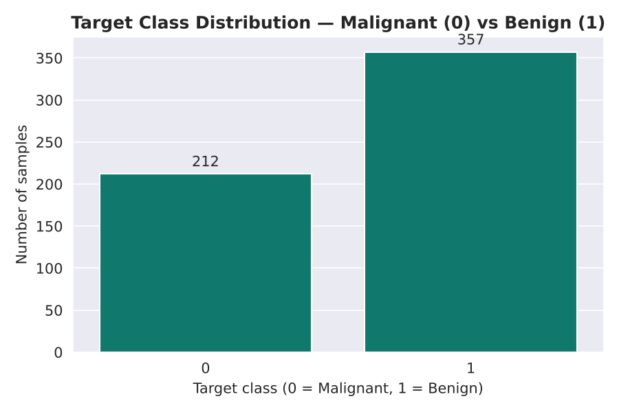
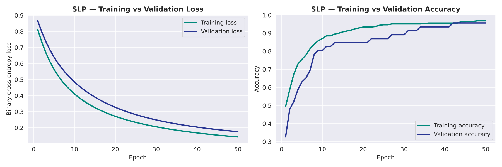
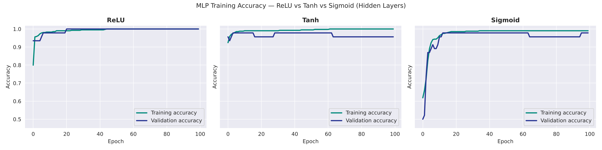
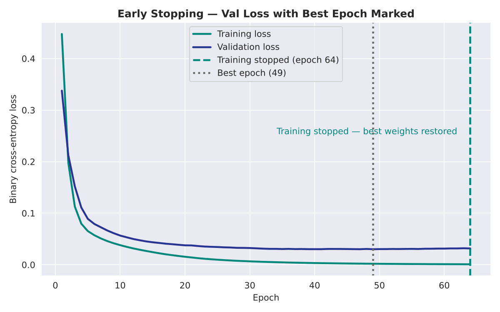
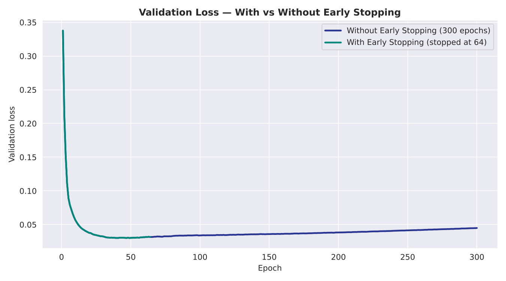
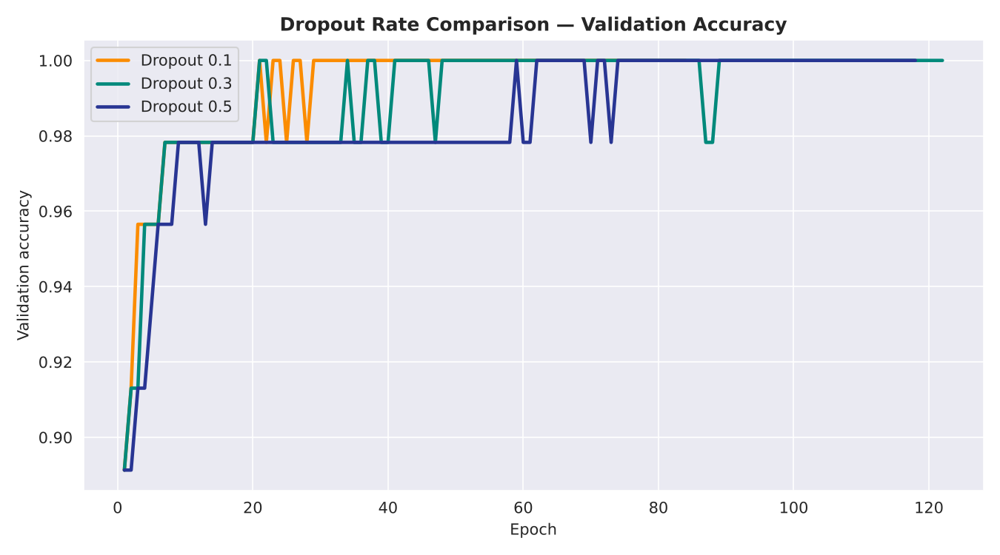
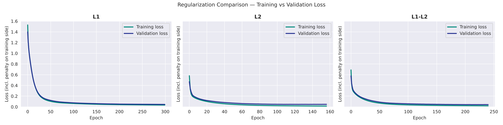
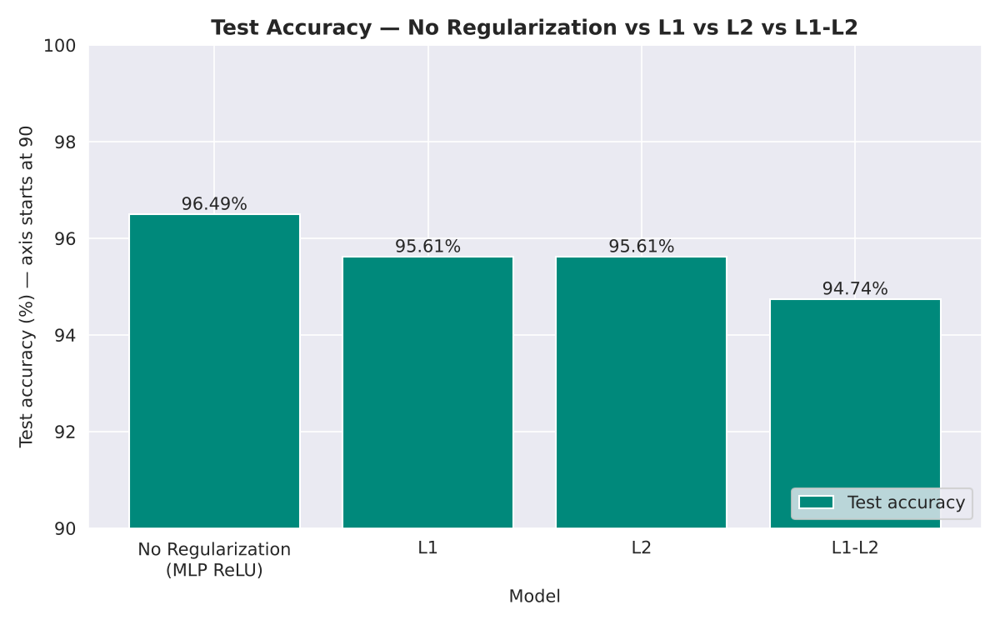

# Deep Learning PR 1 — Breast Cancer Diagnosis: From a Single Neuron to a Regularized MLP

**Red & White Skill Education · Deep Learning · PR 1**
Author: *YOUR NAME* · GRID: *YOUR GRID*

## Dataset
Breast Cancer Wisconsin (Diagnostic), loaded with `sklearn.datasets.load_breast_cancer(as_frame=True)` (also on the [UCI repository](https://archive.ics.uci.edu/dataset/17/breast+cancer+wisconsin+diagnostic)).
569 samples (212 Malignant = 0, 357 Benign = 1), 30 numeric features, no missing values. 80/20 stratified split, `StandardScaler` fitted on the training set only.

## Topics covered
1. **Data scaling** — StandardScaler fitted on train only; why gradient-based optimisers need scaled inputs.
2. **SLP** — one sigmoid neuron (31 parameters) as a linear baseline.
3. **MLP & activation functions** — 30-64-32-1 network, ReLU vs Tanh vs Sigmoid in hidden layers.
4. **Early Stopping** — `monitor='val_loss'`, `patience=15`, `restore_best_weights=True`; with vs without comparison.
5. **Dropout** — rates 0.1 / 0.3 / 0.5 compared, training vs inference behaviour.
6. **Regularization** — L1, L2 and L1-L2 (ElasticNet), including a check of L1 weight sparsity.
7. **Final model & clinical discussion** — Dropout + L2 + Early Stopping, full results table, precision/recall and threshold reasoning.

## Key plots (`/plots`)
| Plot | Caption |
|---|---|
|  | Class distribution (212 vs 357) |
|  | SLP training vs validation loss / accuracy |
|  | ReLU vs Tanh vs Sigmoid hidden layers |
|  | Early Stopping: stop epoch 64, best epoch 49 |
|  | Validation loss with vs without Early Stopping |
|  | Dropout rate comparison (validation accuracy) |
|  | L1 / L2 / L1-L2 training vs validation loss |
|  | Test accuracy: none vs L1 vs L2 vs L1-L2 |

## Results (test set, 114 samples; precision / recall / F1 for the **Malignant** class)
| Model                         | Regularization   |   Dropout Rate | Early Stopping    |   Test Accuracy |   Test Precision |   Test Recall |   Test F1-Score |
|:------------------------------|:-----------------|---------------:|:------------------|----------------:|-----------------:|--------------:|----------------:|
| SLP (Task 2)                  | nan              |            0   | No                |          0.9474 |           0.95   |        0.9048 |          0.9268 |
| MLP-ReLU (Task 3)             | nan              |            0   | No                |          0.9649 |           0.9318 |        0.9762 |          0.9535 |
| MLP + Early Stopping (Task 4) | nan              |            0   | Yes (patience=15) |          0.9649 |           0.9318 |        0.9762 |          0.9535 |
| MLP + Dropout-best (Task 5)   | nan              |            0.5 | Yes (patience=20) |          0.9561 |           0.9111 |        0.9762 |          0.9425 |
| MLP + L2 (Task 6)             | L2 (0.001)       |            0   | Yes (patience=20) |          0.9561 |           0.9111 |        0.9762 |          0.9425 |
| Final Combined (Task 7.1)     | L2 (0.001)       |            0.3 | Yes (patience=20) |          0.9561 |           0.9111 |        0.9762 |          0.9425 |

One test sample is about 0.9 %, so the differences between the MLP variants are within noise. The clear gain is SLP → MLP (missed malignant cases 4 → 1).

## Tools
Python 3, TensorFlow/Keras, scikit-learn, pandas, NumPy, matplotlib, seaborn.

## Run it
```bash
pip install -r requirements.txt
jupyter nbconvert --to notebook --execute DL_PR1.ipynb
```
