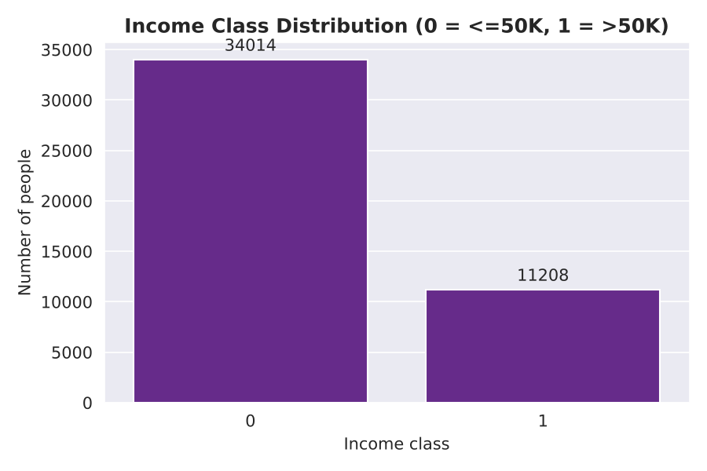
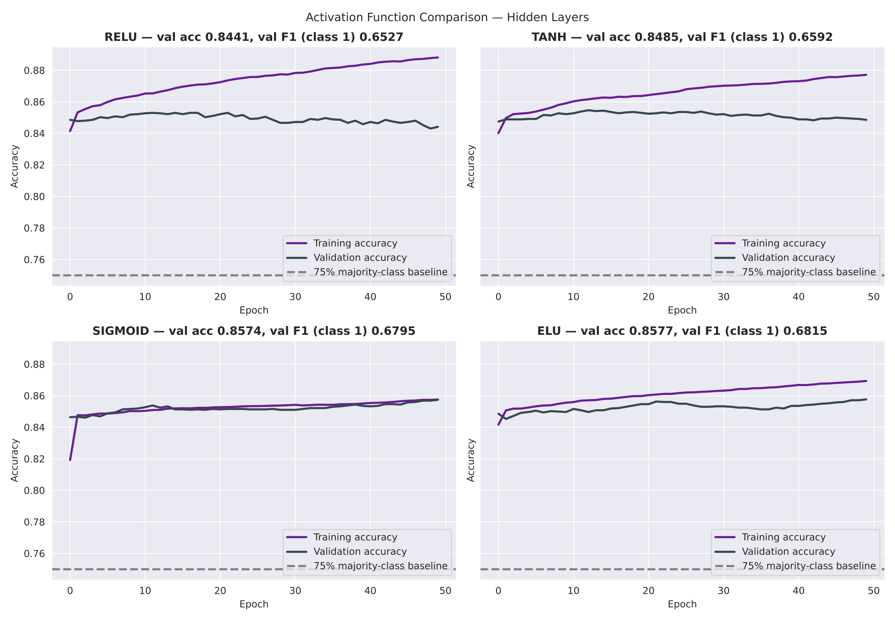
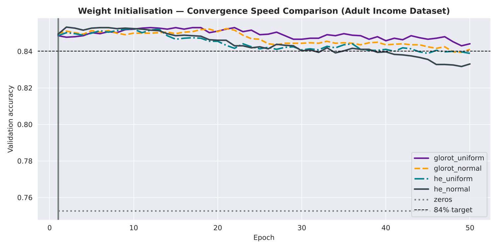
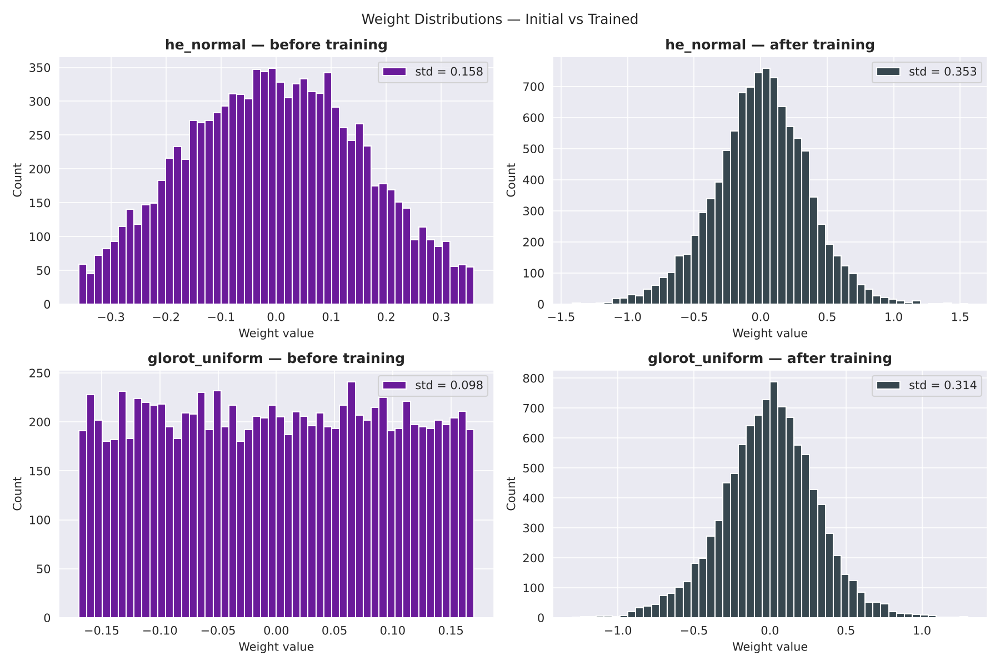
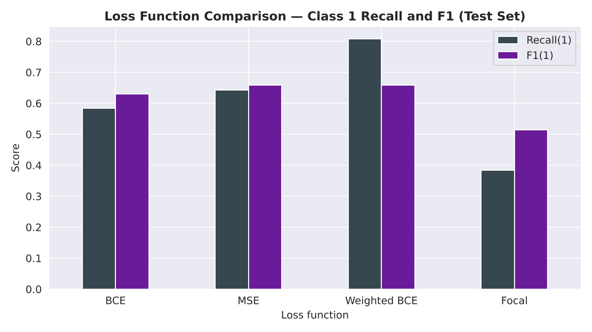
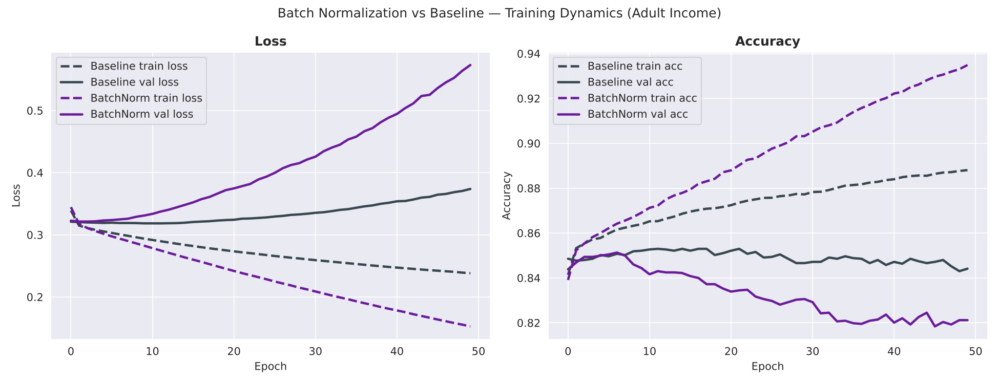
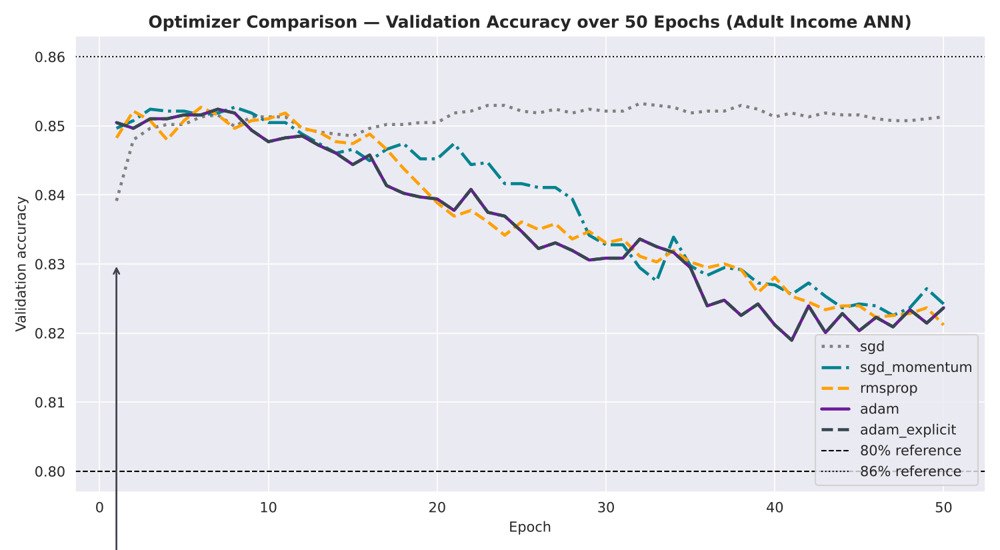
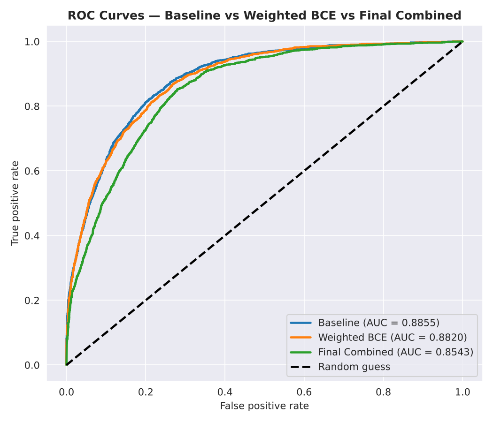
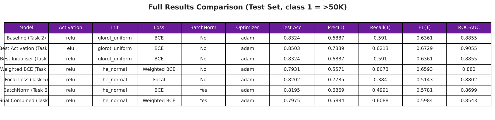

# Deep Learning PR 2 — Predicting Income Above $50K with a Neural Network (Adult Census)

**Red & White Skill Education · Deep Learning · PR 2**
Author: *YOUR NAME* · GRID: *YOUR GRID*

## Dataset
Adult Income (Census Income) dataset, 48,842 rows, 14 features, target = income `>50K` (1) or `<=50K` (0).
UCI: https://archive.ics.uci.edu/dataset/2/adult · Kaggle: https://www.kaggle.com/datasets/wenruliu/adult-income-dataset

## Preprocessing
1. Stripped spaces from all text columns.
2. Replaced `?` with `NaN` and **dropped** those rows (45,222 rows left): the missing columns are categorical with many classes, so mode imputation would inflate the most common category.
3. Dropped `fnlwgt` (survey weight) and `education` (same as `educational-num`).
4. Encoded income as 0/1 (about 75% / 25%, so F1 of class 1 is the main metric).
5. One-hot encoding with `pd.get_dummies(drop_first=True)` → 80 columns.
6. `StandardScaler` on the 5 numeric columns only (not the 0/1 columns), fitted on train only.
7. Stratified 80/20 split (`random_state=42`).

## make_ann() parameters
| Parameter | Default | Meaning |
|---|---|---|
| input_dim | — | number of input columns (80) |
| hidden_units | [128, 64] | neurons in each hidden layer |
| activation | relu | hidden activation |
| initializer | glorot_uniform | weight initialiser |
| use_batch_norm | False | add BatchNorm (Dense → BN → Activation) |
| optimizer | adam | optimizer |
| loss | binary_crossentropy | loss function |

## Topics covered
1. **MLP / baseline ANN** — reusable `make_ann()`, 18,689 parameters, sigmoid output.
2. **Activation functions** — ReLU, Tanh, Sigmoid, ELU; dead-neuron check and gradient-flow check.
3. **Weight initialization** — Glorot/He (uniform, normal) and zeros (symmetry problem).
4. **Loss functions** — BCE, MSE, Weighted BCE and Focal Loss on the imbalanced data.
5. **Batch Normalization** — with vs without, position before/after activation, learned gamma/beta.
6. **Optimizers** — SGD, SGD + Momentum, RMSprop, Adam, and learning-rate sensitivity.

## Plots (`/plots`)
| Plot | Caption |
|---|---|
|  | Class balance (75% / 25%) |
|  | ReLU / Tanh / Sigmoid / ELU, 75% majority baseline |
|  | Initialiser convergence |
|  | Weights before and after training |
|  | Class-1 Recall and F1 by loss function |
|  | BatchNorm vs baseline training dynamics |
|  | Optimizer comparison |
|  | ROC curves: Baseline, Weighted BCE, Final |
|  | Full results table |

## Results (test set, class 1 = >50K)
| Model                     | Activation   | Init           | Loss         | BatchNorm   | Optimizer   |   Test Acc |   Prec(1) |   Recall(1) |   F1(1) |   ROC-AUC |
|:--------------------------|:-------------|:---------------|:-------------|:------------|:------------|-----------:|----------:|------------:|--------:|----------:|
| Baseline (Task 2)         | relu         | glorot_uniform | BCE          | No          | adam        |     0.8324 |    0.6887 |      0.591  |  0.6361 |    0.8855 |
| Best Activation (Task 3)  | elu          | glorot_uniform | BCE          | No          | adam        |     0.8503 |    0.7339 |      0.6213 |  0.6729 |    0.9055 |
| Best Initialiser (Task 4) | relu         | glorot_uniform | BCE          | No          | adam        |     0.8324 |    0.6887 |      0.591  |  0.6361 |    0.8855 |
| Weighted BCE (Task 5)     | relu         | he_normal      | Weighted BCE | No          | adam        |     0.7931 |    0.5571 |      0.8073 |  0.6593 |    0.882  |
| Focal Loss (Task 5)       | relu         | he_normal      | Focal        | No          | adam        |     0.8202 |    0.7785 |      0.384  |  0.5143 |    0.8802 |
| BatchNorm (Task 6)        | relu         | he_normal      | BCE          | Yes         | adam        |     0.8195 |    0.6869 |      0.4991 |  0.5781 |    0.8699 |
| Final Combined (Task 7)   | relu         | he_normal      | Weighted BCE | Yes         | adam        |     0.7975 |    0.5884 |      0.6088 |  0.5984 |    0.8543 |

Main findings: the network overfits after about 10–20 epochs, so many "expected" gains (He init, Adam, BatchNorm) did not show up in 50 fixed epochs. Class weighting raised Recall of >50K from 0.58 to 0.81, and ELU gave the best F1 and ROC-AUC. The final combined model (80 epochs, no Early Stopping) overfits and does worse than the baseline; the next step is to add Early Stopping. Details are in the notebook.

## Tools
Python 3, TensorFlow/Keras, scikit-learn, pandas, NumPy, matplotlib, seaborn.

## Run it
Put `adult.csv` next to the notebook, then:
```bash
pip install -r requirements.txt
jupyter nbconvert --to notebook --execute DL_PR2.ipynb
```
